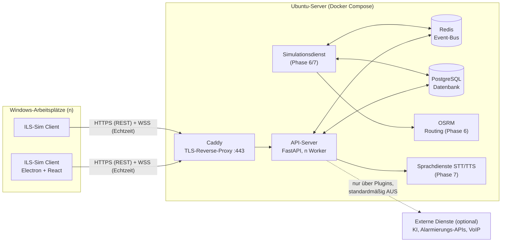

# 01 – Systemarchitektur und Technologieentscheidungen

## 1. Überblick

ILS-Sim ist eine Client-Server-Anwendung. Ein zentraler Ubuntu-Server hält alle Daten und
koordiniert Echtzeit und Simulation. Beliebig viele Windows-Arbeitsplätze greifen über eine
TLS-verschlüsselte Verbindung darauf zu.



### Leitprinzipien

1. **Der Server ist die einzige Wahrheit.** Clients halten keinen eigenen Datenbestand. Jede
   Änderung läuft über die API, wird transaktional gespeichert, protokolliert und per
   Echtzeit-Event an alle betroffenen Arbeitsplätze verteilt.
2. **Simulation ist zentral.** Fahrzeugbewegungen, Statuswechsel und simulierte Anrufe
   berechnet ein serverseitiger Simulationsdienst. Dadurch sehen alle Disponenten
   denselben Zustand.
3. **Simulation und Echtbetrieb sind technisch getrennt.** Das gilt auf drei Ebenen:
   systemweiter Betriebsmodus, Kennzeichnung je Schnittstelle (`is_real`) und eine
   eigene Berechtigung `interfaces.activate_real`. Details siehe
   [05-sicherheit.md](05-sicherheit.md).
4. **Module statt Monolith.** Fachmodule (Einsatz, Alarmierung, Fahrzeuge, Simulation …)
   sind im Server eigene Pakete mit Service-Schicht und im Client eigene Panels. Sie
   kommunizieren über definierte Schnittstellen (Services, Events, Plugin-Protokolle).
5. **Keine Schein-Funktionen.** Nicht implementierte Module sind im Client als „geplant“
   gekennzeichnet. Der Server liefert dazu einen maschinenlesbaren Modulstatus
   (`GET /api/v1/system/info`).

## 2. Komponenten

### 2.1 Server (`server/`)

```text
app/
├── core/          Konfiguration, Logging, Fehlerformat, Sicherheit (Passwörter, JWT),
│                  Verschlüsselung (SecretBox), Berechtigungskatalog
├── db/            SQLAlchemy-Basis, Mixins (UUID, Zeitstempel, Optimistic Locking)
├── models/        ORM-Modelle (eine Datei je Fachbereich)
├── schemas/       Pydantic-Verträge der API (Ein-/Ausgabe, getrennt von den Modellen)
├── services/      Fachlogik; Unit of Work = Transaktion + Audit + Events
├── api/           FastAPI-Router, Abhängigkeiten (Auth, Rechte), WebSocket-Endpunkt
├── realtime/      Event-Bus (In-Memory / Redis) und WebSocket-Hub
├── plugins/       Schnittstellen-Plugins (ab Phase 4)
└── cli.py         Verwaltungskommandos (bootstrap, seed-demo, Schlüssel erzeugen)
```

Die Schichtung ist strikt: Router → Service → Modelle. Router enthalten keine Fachlogik.
Services kennen kein HTTP.

**Unit of Work** (`services/uow.py`): Jede schreibende Operation läuft in genau einer
Transaktion. Der Audit-Eintrag wird in derselben Transaktion geschrieben, eine Änderung ohne
Protokolleintrag kann also nicht committet werden. Echtzeit-Events werden erst nach dem
erfolgreichen Commit veröffentlicht. Clients sehen deshalb nie Änderungen, die zurückgerollt
wurden.

### 2.2 Echtzeit

- WebSocket `/api/v1/ws`. Authentifizierung über die erste Nachricht; das Token taucht
  dadurch nie in URLs oder Proxy-Logs auf.
- **Event-Bus:** Im Einzelbetrieb arbeitet er im Prozess (In-Memory). Bei mehreren
  API-Workern und dem Simulationsdienst läuft er über Redis Pub/Sub. Jeder Prozess
  abonniert den Bus und stellt die Events an seine eigenen Verbindungen zu.
- **Zustellungsbereich:** Jedes Event trägt Kanäle (`broadcast`, `cc:<leitstelle>`,
  `user:<id>`) und optional eine Pflichtberechtigung. Ein Disponent erhält nur Events seiner
  Leitstellen und nur solche, für die er berechtigt ist.
- **Gegendruck (Backpressure):** Jede Verbindung hat eine begrenzte Sendewarteschlange und
  eine eigene Sendetask. Ein langsamer Client kann die anderen nicht ausbremsen. Läuft die
  Warteschlange über, wird die Verbindung mit Code 4008 getrennt und der Client
  synchronisiert sich neu.
- **Wiederverbindung:** Der Client verbindet sich mit exponentiellem Backoff und Jitter neu
  und lädt danach alle Daten per REST nach (`onResync`). Events aus der Offline-Zeit werden
  bewusst nicht nachgeliefert. So bleibt der Server zustandslos, und der REST-Stand ist
  maßgeblich.
- **Sitzungskontrolle:** Wird ein Benutzer deaktiviert, sein Passwort geändert, seine
  Sitzung abgemeldet oder werden seine Rechte geändert, trennt der Server dessen
  WebSocket-Verbindungen auf allen Instanzen aktiv (Steuerereignis über den Bus).

### 2.3 Windows-Client (`client/`)

```text
src/
├── main/       Electron-Hauptprozess: Fenster, Sicherheitshärtung, app://-Protokoll,
│               lokale Konfiguration (Serveradresse, Arbeitsplatzname)
├── preload/    minimale Brücke Renderer ↔ Hauptprozess (contextBridge)
└── renderer/   React-Oberfläche
    └── src/
        ├── api/        HTTP-Client (Token-Erneuerung), Echtzeit-Client, Datenabfragen
        ├── auth/       Anmeldung, Passwortänderung
        ├── layout/     Andockbarer Arbeitsbereich, Arbeitsplatz-Profile
        ├── modules/    Modul-Registry, Panels (je Fachmodul ein Panel)
        ├── shell/      Kopfzeile, Statusleiste, Uhr (Serverzeit)
        ├── state/      Sitzung, Systemmeldungen
        └── theme/      Design-Tokens (dunkles Leitstellen-Theme), Shell-Layout
```

- **Arbeitsplätze:** Einsatzannahme (F2), Disposition (F3), Funk (F4), Verwaltung (F5) und
  Administrator (F6). Jeder Arbeitsplatz setzt eine Berechtigung voraus und hat ein
  Standardlayout.
- **Frei anordnen:** Fenster lassen sich ziehen, teilen, als Tabs gruppieren und frei
  schweben lassen. Das Layout wird je Benutzer und Arbeitsplatz auf dem Server gespeichert.
  Ein Disponent findet seine Anordnung deshalb an jedem PC wieder.
- **Neue Module** werden in `modules/registry.ts` registriert. Menüs, Layouts und
  Rechteprüfung greifen automatisch.
- **Fehlerisolation:** Jedes Panel läuft in einer eigenen Error Boundary. Ein Modulfehler
  legt nicht den ganzen Arbeitsplatz lahm.

### 2.4 Simulationsdienst (ab Phase 6)

Ein eigener Prozess aus derselben Codebasis (`python -m app.simulation`). Er läuft in einem
festen Takt (Standard 1 s):

1. Er lädt die aktiven Fahrzeugbewegungen (Route, Startzeit, Geschwindigkeitsprofil).
2. Er interpoliert die Position entlang der Routengeometrie.
3. Er veröffentlicht Positionsupdates gebündelt als ein Event je Leitstelle und Takt, nicht
   eines je Fahrzeug.
4. Er erkennt Ankünfte, setzt Status 4 über die reguläre Fahrzeug-Service-Schicht und
   schreibt den Einsatzverlauf.

Damit ist garantiert, dass alle Clients identische Positionen sehen. Fällt der Dienst aus,
bleibt der Rest des Systems bedienbar. Fahrzeuge „stehen“ dann, und die Statusleiste zeigt
die Störung an. Details: [06-simulation-und-kernfunktionen.md](06-simulation-und-kernfunktionen.md).

## 3. Technologieentscheidungen

| Bereich | Entscheidung | Begründung | Verworfene Alternativen |
|---|---|---|---|
| Windows-Client | **Electron 45 + React 19 + TypeScript** | Erstklassige Webtechnik für Karten (MapLibre GL), Audio und VoIP (WebRTC, getUserMedia, SIP.js) sowie komplexe Fensterlayouts (dockview). Electron bringt eine feste Chromium-Version mit, Audio und WebRTC verhalten sich also auf jedem PC gleich. Native Fensterintegration, NSIS-Installer. Unter Linux testbar (CI) | **WPF/.NET:** sehr nativ, aber schwächere Karten- und WebRTC-Bibliotheken, nur unter Windows bau- und testbar. **Tauri:** klein, aber WebView2-Versionsdrift bei WebRTC und Audio, zusätzliche Rust-Toolchain. **Qt/PySide:** Lizenzfragen, Karten und WebRTC aufwendig |
| Fensterlayout | **dockview** | Andocken, Tabs, Schwebefenster, (De-)Serialisierung des Layouts, aktiv gepflegt | golden-layout (veraltet), FlexLayout (weniger flexibel) |
| Client-Daten | **TanStack Query + Zustand** | Server-Cache mit gezielter Invalidierung durch Echtzeit-Events, schlanker globaler Zustand | Redux (mehr Boilerplate) |
| Backend | **Python 3.13, FastAPI, Pydantic v2** | Asynchron (WebSockets, viele gleichzeitige Verbindungen), typisierte Verträge, automatische OpenAPI-Doku. Stärkstes Ökosystem für KI, Sprache (Anthropic-SDK, faster-whisper, Piper), Geodaten und Excel (openpyxl) | Node/NestJS (KI-/Sprach-Ökosystem schwächer), .NET (gut, aber Sprach-/KI-Werkzeuge weniger verbreitet) |
| Datenbank | **PostgreSQL 16** | Transaktionen, JSONB (Layouts, Konfigurationen), Trigger (unveränderbares Protokoll), ausgereift. PostGIS ist bei Bedarf nachrüstbar | SQLite (nicht mehrbenutzerfähig), MySQL (schwächere JSON- und Triggerfunktionen) |
| ORM/Migrationen | **SQLAlchemy 2 (async) + Alembic** | Typisierte Modelle, Optimistic Locking eingebaut, versionierte Migrationen | – |
| Echtzeit-Bus | **Redis 7 (Pub/Sub)** | Verteilung zwischen API-Workern und Simulationsdienst; später auch flüchtige Daten (aktuelle Positionen) | PostgreSQL LISTEN/NOTIFY (8-KB-Grenze, belastet die DB), Kafka (überdimensioniert) |
| TLS | **Caddy** | Automatisches TLS: interne CA für Netze ohne öffentlichen DNS-Namen oder Let's Encrypt. Minimale Konfiguration | nginx + certbot (mehr Handarbeit) |
| Betrieb | **Docker Compose auf Ubuntu** | Reproduzierbar, einfache Updates, Dienste isoliert | Kubernetes (für eine Leitstelle überdimensioniert) |
| Karten | **MapLibre GL JS**, Kacheln konfigurierbar | Vektor- und Rasterkacheln, performant bei vielen Markern | Leaflet (für viele bewegte Objekte schwächer) |
| Routing | **OSRM** (selbst betrieben, OSM-Daten der Region) | Sehr schnell, `route`- und `table`-Dienst (Fahrzeitmatrix für den Einsatzmittelvorschlag), offline. Über ein Interface austauschbar | **Valhalla:** flexiblere Kostenmodelle und Isochronen, langsamer; als zweiter Provider vorgesehen |
| KI-Anrufer | **Claude über das Anthropic Python SDK**, Modell konfigurierbar (Standard `claude-opus-5-5`, niedriger Effort) | Starkes Rollenspiel auf Deutsch, Streaming, strukturierte Ausgaben für die Auswertung. Über ein Provider-Interface austauschbar | – |
| Spracherkennung | **faster-whisper** lokal (Plugin für Cloud-STT) | Gutes Deutsch, offline, datenschutzfreundlich | Web Speech API (in Electron nicht verfügbar) |
| Sprachausgabe | **Piper** lokal (Plugin für Cloud-TTS) | Natürliche deutsche Stimmen, offline, schnell | – |
| Telefonie | **Asterisk (PJSIP + WebRTC)** für echte VoIP, **eigener Simulationsprovider** für Training | Bewährte Open-Source-Telefonanlage. Der Client spricht SIP über WSS. Simulation und echte Telefonie sind getrennte Provider | FreeSWITCH (gleichwertig, mehr Konfigurationsaufwand) |

> **Hinweis zu den Werkzeugversionen:** TypeScript 7, Vite 8 und Electron 45 sind exakt
> gepinnt (`package-lock.json`). Updates erfolgen bewusst und mit CI-Lauf.

## 4. Schnittstellen zwischen den Modulen

Siehe [03-api-und-module.md](03-api-und-module.md): REST-Konventionen, WebSocket-Protokoll,
interne Provider-Interfaces (Routing, Positionsquelle, Alarmierung, Telefonie, Sprache, KI)
und das Plugin-System.

## 5. Mehrbenutzerbetrieb und Konflikte

- **Optimistic Locking:** Jeder änderbare Datensatz hat eine `version`. Updates müssen
  `expected_version` mitsenden. Weicht diese ab, antwortet der Server mit `409 Conflict` und
  liefert `current_version`. Der Client zeigt dann „von einer anderen Person geändert – neu
  laden“. Zusätzlich prüft die Datenbank die Version beim UPDATE. Damit sind auch echte
  Gleichzeitigkeiten (zwei Requests in derselben Millisekunde) abgesichert.
- **Fachliche Sperren** (ab Phase 3): Ein Fahrzeug kann nur einem Einsatz zugeordnet sein.
  Das wird per `SELECT … FOR UPDATE` in der Zuordnungstransaktion geprüft.
- **Idempotenz** (ab Phase 4): Alarmierungen tragen einen `Idempotency-Key`, damit ein
  wiederholter Klick oder eine Netzwerkwiederholung nicht doppelt alarmiert.

## 6. Offline-Verhalten

- Verliert ein Client die Verbindung, zeigen Statusleiste und Systemmeldungen sofort
  „Verbindung unterbrochen“ an. Der Client verbindet sich automatisch neu.
- Schreibaktionen ohne Verbindung schlagen sichtbar fehl, mit Fehlermeldung und Fehler-ID.
  Es gibt **bewusst keine Offline-Schreibwarteschlange**: Im Leitstellenbetrieb ist eine
  verspätet übertragene Alarmierung gefährlicher als eine sofort sichtbar fehlgeschlagene.
- Nach der Wiederverbindung lädt der Client alle Daten neu (`onResync`).
