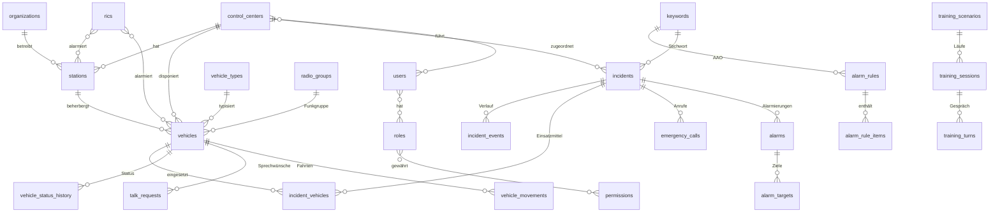

# 02 – Datenbankplanung

PostgreSQL 16. Primärschlüssel sind UUIDs, nur bei reinen Protokolltabellen `bigint`. Alle
Zeitstempel sind `timestamptz` in UTC; die Anzeige erfolgt in Ortszeit. Änderbare Stammdaten
und Einsätze haben eine `version`-Spalte (Optimistic Locking) sowie `created_at` und
`updated_at`. Schemaänderungen erfolgen ausschließlich über Alembic-Migrationen
(`server/alembic/versions`).

**Mandantentrennung:** Operative Daten (Wachen, Fahrzeuge, Einsätze …) tragen eine
`control_center_id`. Die API filtert immer auf die Leitstellen des Benutzers.
`system.admin` sieht alle.

## 1. Umgesetzt (Phase 1)

| Tabelle | Zweck | Wichtige Spalten |
|---|---|---|
| `control_centers` | Leitstellen (Mandanten) | `code` (eindeutig), `name`, `address`, `latitude`, `longitude`, `is_active`, `version` |
| `users` | Benutzerkonten | `username` (eindeutig, klein), `password_hash` (Argon2id), `is_active`, `must_change_password`, `failed_login_count`, `locked_until`, `token_version`, `version` |
| `roles` | Rollen (frei definierbar; 5 Systemrollen) | `key`, `name`, `is_system`, `version` |
| `permissions` | Berechtigungskatalog (aus Code synchronisiert) | `code` (PK, z. B. `alarm.trigger`), `area`, `description` |
| `role_permissions` | Rolle ↔ Berechtigung | |
| `user_roles` | Benutzer ↔ Rolle (n:m) | |
| `user_permission_overrides` | Individuelle Rechte je Benutzer | `permission_code`, `effect` (`grant`/`deny`; deny gewinnt) |
| `user_control_centers` | Benutzer ↔ Leitstelle (n:m) | |
| `auth_sessions` | Anmeldesitzungen (Refresh-Token-Familie) | `expires_at`, `revoked_at`, `revoke_reason`, `client_name`, `workstation`, `ip_address` |
| `refresh_tokens` | Einmal-Refresh-Tokens (nur SHA-256-Hash) | `token_hash`, `used_at` |
| `login_events` | Anmeldeprotokoll | `username`, `success`, `event`, `reason`, `ip_address`, `workstation` |
| `audit_log` | **Unveränderbares** Änderungsprotokoll | `ts`, `actor_user_id`, `actor_name`, `action`, `entity_type`, `entity_id`, `control_center_id`, `summary`, `changes` (JSONB: Feld → alt/neu), `request_id` |
| `user_layouts` | Fensterlayout je Benutzer und Arbeitsplatz | `workstation`, `layout` (JSONB), `version` |
| `system_settings` | Systemweite Einstellungen | `key`, `value` (JSONB), z. B. `operation_mode` = `simulation`/`real` |

**Schutz des Änderungsprotokolls:** Ein Datenbank-Trigger lehnt `UPDATE` und `DELETE` auf
`audit_log` ab, auch bei direktem SQL-Zugriff. `audit_log` hat absichtlich **keine
Fremdschlüssel**. Ein `ON DELETE SET NULL` wäre selbst eine Änderung am Protokoll und würde
das Löschen referenzierter Datensätze blockieren. Der Name des Handelnden wird deshalb
zusätzlich als Text gespeichert.

## 2. Tabellen je Phase (Phasen 2–4 umgesetzt, 5–7 geplant)

### Phase 2 – Stammdaten (✅ umgesetzt, Migration `0002`)

Umgesetzt wie geplant, mit folgenden Präzisierungen: RIC-Zuordnungen über `station_rics` und
`vehicle_rics` (beidseitig pflegbar), Alarmierungsgruppen über `alarm_group_rics`,
Funkrufgruppen über `radio_group_stations` / `radio_group_organizations` (Fahrzeuge über
`vehicles.radio_group_id`). `vehicle_status_definitions` (ursprünglich Phase 6) wurde vorgezogen,
weil Fahrzeuge bereits einen Status tragen. Funkrufname und Wachenname sind je Leitstelle ohne
Beachtung der Groß-/Kleinschreibung eindeutig (funktionaler Index). Ein Check-Constraint
verhindert eine alarmierbare Polizei. Die Position eines Fahrzeugs an seiner Wache wird nicht
kopiert, sondern aus der Wache abgeleitet (`position_source = station`).

| Tabelle | Zweck / Spalten |
|---|---|
| `organizations` | Feuerwehr, Rettungsdienst, THW, DRK, …, Polizei (nur Information). `kind`, `name`, `alarmable` (Polizei = false) |
| `control_center_links` | Verknüpfte Leitstellen (Nachbarleitstellen, Überlauf). `from_id`, `to_id`, `kind` |
| `control_center_areas` | Zuständigkeitsbereiche. `control_center_id`, `name`, `geometry` (GeoJSON-Polygon) oder Gemeindeschlüssel |
| `stations` | Wachen. `control_center_id`, `organization_id`, `name`, `short_name`, `address`, `latitude`, `longitude`, `availability` (JSONB: Zeiten), `is_active`, `osm_ref` (Herkunft) |
| `vehicle_types` | Fahrzeugtypen. `code` (HLF20, RTW, NEF, DLK23 …), `name`, `category`, `default_speed_kmh`, `capabilities` (JSONB: Wasser, Leiter, Patiententransport …) |
| `vehicles` | Fahrzeuge. `control_center_id`, `station_id`, `organization_id`, `vehicle_type_id`, `call_sign` (Funkrufname, eindeutig je Leitstelle), `license_plate`, `status_code`, `status_changed_at`, `latitude`, `longitude`, `position_source` (`sim`/`gps`), `radio_group_id`, `available`, `crew_size`, `description`, `sim_speed_kmh`, `import_job_id` |
| `rics` | Funkmeldeempfänger-Adressen. `control_center_id`, `code` (z. B. 1234567), `sub_address` (A–D), `description` |
| `ric_assignments` | RIC ↔ Wache / Fahrzeug |
| `alarm_groups` | Alarmierungsgruppen (Bündel von RICs) + `alarm_group_members` |
| `radio_groups` | Funkrufgruppen. `control_center_id`, `name`, `talkgroup` (Kennung), `kind` + Zuordnung zu Wachen, Organisationen, Fahrzeugen (`radio_group_assignments`) |
| `import_jobs` | Excel/CSV-Importe. `kind` (`vehicles`/`stations`), `file_name`, `column_mapping` (JSONB), `preview` (JSONB), `status` (`uploaded` → `mapped` → `validated` → `confirmed`/`discarded`), `errors` (JSONB), `created_by` |

### Phase 3 – Notrufannahme und Einsätze (✅ umgesetzt, Migration `0003`)

Umgesetzt mit folgenden Präzisierungen: `keywords` (Stichwortkatalog: Kürzel, Bezeichnung,
Einsatzart, Standardpriorität) wurde aus Phase 4 vorgezogen; Phase 4 ergänzt Alarmierungsregeln
und Polizei-Hinweis. `incident_stations` entfällt – beteiligte Wachen ergeben sich aus den
zugeordneten Fahrzeugen (Phase 4 ergänzt ggf. wachenbezogene Alarmierungen). Einsatznummern
`JJJJ-NNNNNN` sind je Leitstelle und Jahr lückenlos (`incident_number_sequences`, Zeile wird
in der Transaktion gesperrt). `incident_events` ist per Trigger unveränderbar. Ein
partieller eindeutiger Index auf `incident_vehicles(vehicle_id) WHERE released_at IS NULL`
garantiert, dass ein Fahrzeug höchstens einem Einsatz zugeordnet ist. Notrufe speichern bei
Simulation das simulierte Gesprächsprotokoll (`sim_transcript`).

| Tabelle | Zweck / Spalten |
|---|---|
| `emergency_calls` | Notrufe. `control_center_id`, `status` (`ringing`, `active`, `on_hold`, `ended`), `priority`, `caller_name`, `caller_phone`, `caller_lat/lon`, `address`, `reason`, `incident_id` (Zuordnung), `source` (`sim`/`voip`/`training`), `received_at`, `answered_at`, `ended_at`, `handled_by` |
| `call_notes` | Gesprächsnotizen und Rückfragen (zeitgestempelt) |
| `incident_number_sequences` | Einsatznummern je Leitstelle und Jahr (lückenlos, transaktional) |
| `incidents` | Einsätze. `control_center_id`, `number` (z. B. 2026-004711), `keyword_id`, `incident_type`, `address`, `latitude`, `longitude`, `caller_name`, `caller_phone`, `description`, `priority`, `status` (`new`, `in_progress`, `alarmed`, `en_route`, `on_scene`, `finished`, `closed`), `created_at`, `closed_at`, `version` |
| `incident_events` | Einsatzverlauf (Zeitstrahl, append-only). `type` (`status`, `vehicle_assigned`, `alarm`, `note`, `arrival` …), `payload` (JSONB), `actor` |
| `incident_vehicles` | Fahrzeugzuordnung mit Zeitstempeln: `assigned_at`, `alarmed_at`, `s3_at`, `s4_at`, `released_at`, `released_reason` |
| `incident_stations` | Beteiligte Wachen |

### Phase 4 – Alarmierung und Schnittstellen (umgesetzt, Migration `0004`)

| Tabelle | Zweck / Spalten |
|---|---|
| `keywords` (erweitert) | `police_notice` (bool), `police_notice_text`. Standard: H2, H-KLEMM, B-MIG, W1, ABC2, MANV mit Hinweistext (einmalig gesetzt, danach frei änderbar) |
| `alarm_rules` | AAO je Leitstelle und Stichwort, optional je Zuständigkeitsbereich (`area_id`). Eindeutig je (Leitstelle, Stichwort, Bereich) über einen Ausdrucks-Index. `name`, `is_active`, `version` |
| `alarm_rule_items` | Zeilen der AAO: `stage` (1–9, 1 = Erstalarm), `position`, `kind` (`vehicle_type`/`vehicle`/`station`/`ric`/`alarm_group`/`interface`), `count` (1–20, für Fahrzeugtypen), genau eine passende Ziel-Spalte (Check-Constraint `target_matches_kind`), `note` |
| `alarms` | Bestätigte Alarmierungen. `kind` (`initial`/`follow_up`), `stage`, `mode` (Betriebsmodus zum Zeitpunkt), `status` (`pending`/`completed`/`partial`), `idempotency_key` + `request_hash` (eindeutig je Einsatz), `triggered_by(_name)`, `note` |
| `alarm_targets` | Ziele je Alarmierung: `target_type` (`vehicle`/`station`/`ric`/`interface`), `label`, `reason` (warum im Vorschlag), `delivery_status` (`simulated`/`sent`/`failed`/`skipped`/`not_delivered`/`pending`), `detail`, `delivered_at` |
| `police_notices` | Polizei-Hinweis je Einsatz und Stichwort: Text, angezeigt am, bestätigt von/um, Vermerk. **Keine** Zustellung an die Polizei |
| `interfaces` | Plugin-Instanzen: `plugin_key`, `scope` (`global`/`control_center`/`station`, Check-Constraint), `enabled` (Standard **false**), `config` (JSONB, ohne Geheimnisse), `secret_encrypted` (Fernet), `secret_hint` (`••••1234`), `status`, `last_ok_at`, `last_error`, `last_checked_at`, `version`. Ob ein Plugin „real“ ist, steht im Plugin-Code (`meta.is_real`), nicht in der Datenbank |
| `interface_events` | Ereignis- und Fehlerprotokoll je Schnittstelle (`kind`: `config`, `test`, `delivery`, `redirected`) |

Statusänderungen einer Schnittstelle (ok/Fehler) erhöhen die `version` nicht – sie würden
sonst Bearbeitungskonflikte bei Administratoren auslösen.

### Phase 5 – Einsatzmittelvorschlag

| Tabelle | Zweck / Spalten |
|---|---|
| `proposal_settings` | Gewichtungen und Regeln je Leitstelle (JSONB, versioniert) |
| `proposals` | Gespeicherte Vorschläge zur Nachvollziehbarkeit. `incident_id`, `computed_at`, `inputs` (JSONB), `result` (JSONB mit Begründungen), `accepted_vehicle_ids` |

### Phase 6 – Fahrzeugstatus, Funk und Navigation

| Tabelle | Zweck / Spalten |
|---|---|
| `vehicle_status_definitions` | Administrierbare Statusbezeichnungen. `code` (0–9), `label`, `color`, `counts_as_available` |
| `vehicle_status_history` | Statushistorie (append-only). `vehicle_id`, `status_code`, `source` (`dispatcher`/`simulation`/`gps`/`automatic`), `ts` |
| `talk_requests` | Sprechwünsche. `vehicle_id`, `priority` (normal / dringend = Status 0), `status` (`open`, `accepted`, `deferred`, `rejected`, `done`), `requested_at`, `handled_by`, `handled_at` |
| `vehicle_movements` | Aktive und abgeschlossene Fahrten. `vehicle_id`, `incident_id`, `route_geometry` (encoded polyline), `distance_m`, `duration_s`, `started_at`, `eta`, `finished_at`, `mode` (`sim`) |
| `vehicle_tracks` | Zurückgelegte Strecke (vereinfachte Punkte, monatlich partitioniert) |

### Phase 7 – Telefonie, Sprache und Training

| Tabelle | Zweck / Spalten |
|---|---|
| `training_scenarios` | Szenarien. `title`, `difficulty`, `expected_keyword`, `facts` (JSONB: Wahrheit des Szenarios), `persona` (JSONB), `location_rules`, `checklist` (JSONB: Pflichtfragen), `created_by` |
| `training_sessions` | Trainingsläufe. `scenario_id`, `trainee_id`, `instructor_id`, `status`, `started_at`, `ended_at`, `incident_id` |
| `training_turns` | Gesprächsverlauf. `speaker` (`caller`/`dispatcher`), `text`, `ts`, `audio_ref` (optional, nur bei aktivierter Aufzeichnung) |
| `training_evaluations` | Auswertung. `scores` (JSONB), `findings`, `report` |
| `call_recordings` | Optionale Aufzeichnungen mit Aufbewahrungsfrist (`expires_at`) |

## 3. Beziehungen (Kernmodell)

## 4. Grundsätze

- **Historie statt Überschreiben:** Status, Einsatzverlauf, Alarmierungen und Protokolle
  sind append-only. Der aktuelle Zustand steht denormalisiert am Hauptdatensatz
  (`vehicles.status_code`), die Historie in eigenen Tabellen.
- **Herkunft kennzeichnen:** Spalten wie `source`, `mode` und `position_source`
  unterscheiden Simulation von echten Daten.
- **Geodaten:** Zunächst `latitude`/`longitude` (WGS84) als `double precision`. Entfernungen
  für die Vorauswahl werden per Haversine berechnet, Fahrzeiten per OSRM. PostGIS wird erst
  eingeführt, wenn Flächenabfragen (Zuständigkeitsbereiche) performancekritisch werden.
- **OpenStreetMap:** OSM liefert nur Standorte (Wachen, Straßen, Adressen), keine
  verlässlichen Fahrzeugbestände. Wachen-Importe aus OSM erhalten `osm_ref` und werden vom
  Administrator geprüft. Fahrzeuge stammen ausschließlich aus Excel/CSV-Import oder
  manueller Pflege.
